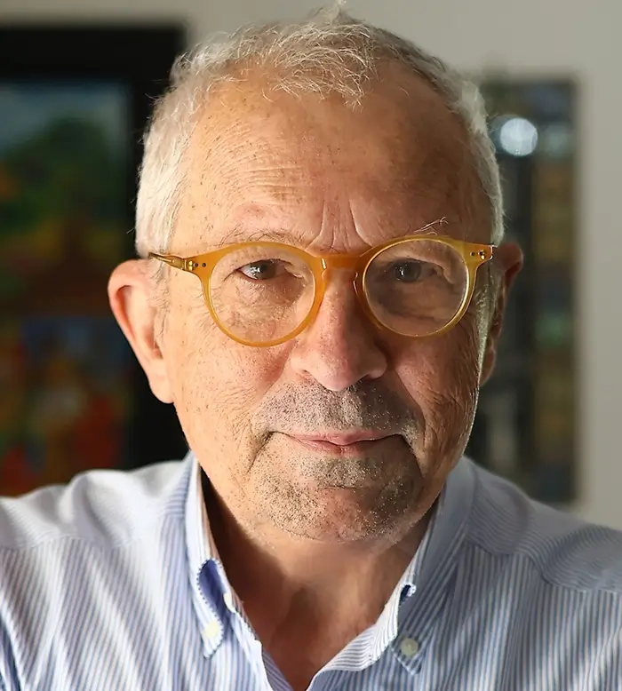

约瑟夫·希发基思（Joseph Sifakis，1946年12月26日 - ），一位出生于希腊的法国计算机科学家，与 爱德蒙·克拉克 和 E. Allen Emerson 共同获得2007年图灵奖，以表彰他们在将模型检查发展为一种高效验证技术，并被硬件和软件行业广泛采用方面所做的工作。

希发基思于1969年在雅典国立技术大学获得电气工程学士学位，1972年在法国格勒诺布尔科学与医学大学（亦称格勒诺布尔第一大学，现更名为约瑟夫·傅里叶大学）获得计算机科学硕士学位，1974年获得工程师博士学位。

希发基思在1974年至1977年间研究 Petri nets 和其他并发系统，在此期间他对 Petri nets 的结构性质和性能评估方面取得了原创且基础性的成果，这些成果如今被广泛用于调度数据流系统。

1977年至1982年间，希发基思将注意力转向 「transition systems」 的验证，他的工作同样取得了显著的成果，并成为了「模型检查」的基础。这是业界最广泛使用的验证方法，首次在 CESAR 模型检查器中实现。

1982年到1988年间，这项工作扩展到模型检查和描述并发系统规范的时序逻辑。CESAR 模型检查器的开发由法国电信资助，广泛用于通信协议的认证。希发基思随后发展了一套理论和技术，被有效用于验证复杂系统。

希发基思曾任法国国家科学研究中心（CNRS）研究主任，于1993年创立了 Verimag Labs，一个位于法国吉耶尔的学术研究实验室，隶属于法国国家科学研究中心和约瑟夫·傅立叶大学。Verimag 获得了空客和施耐德电气的资助，基于希发基思及其团队的成果和工具，空客使用该环境开发安全关键系统超过15年，称为航空领域的事实标准。

2008年，希发基思被任命为法国格勒诺布尔国家信息与自动化研究院（INRIA）智能车载系统研究主席。

> 我认为自治系统是最难构建的，因为它们注定要取代复杂组织中的人类代理，正如工业物联网所设想的那样。这些是实时、分布式的系统，由代理组成，每个代理追求自己的目标，但都必须合作以实现系统的整体目标和集体智慧。

2026年6月29日，希发基思受邀出任曹操出行AI创新中心首席科学顾问，为曹操出行向AI原生公司转型提供核心学术支撑、国际化视野及战略路径规划。

## 参考资料
1.[百度百科-约瑟夫·希发基思](https://baike.baidu.com/item/%E7%BA%A6%E7%91%9F%E5%A4%AB%C2%B7%E5%B8%8C%E5%8F%91%E5%9F%BA%E6%80%9D/24157811?structureClickId=24157811&structureId=ced913fd22dfe016c93805da&structureItemId=46cc373dd004f00b7bae7185&lemmaFrom=starMapContent_star&fromModule=starMap_content&lemmaIdFrom=324645&fromPage=starmap)
2.https://amturing.acm.org/award_winners/sifakis_1701095.cfm
3.[Britannica - Joseph Sifakis](https://www.britannica.com/biography/Joseph-Sifakis)
4.[图灵奖得主Joseph Sifakis出任首席科学顾问，曹操出行加速AI转型](https://news.qq.com/rain/a/20260629A05BTM00)
5.[大模型会毁了年轻程序员](https://36kr.com/p/2519346586428931)
6.https://sifakis.net/