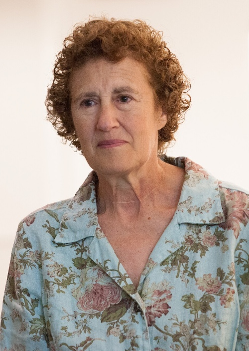

芭芭拉·利斯科夫（Barbara Liskov，1939年11月7日 - ），美国计算机科学家，2008年图灵奖得主以表彰其对编程语言和系统设计的实践与理论基础的贡献，特别是与数据抽象、容错和分布式计算相关的领域。

芭芭拉·利斯科夫，1939年11月7日出生在美国加利福尼亚州的洛杉矶。

1961年，利斯科夫获得加州大学伯克利分校数学学士学位。她没有直接读研究生，而是在在马萨诸塞州的 Mitre 公司担任计算机程序员，在那里她发现自己天生擅长计算机编程。

1963年，利斯科夫回到加利福尼亚，去哈佛大学攻读研究生。因为她早起在自然语言翻译领域的工作，她在约翰·麦卡锡实验室获得了经济支持，成为[约翰·麦卡锡]()的研究生助理，并参与其人工智能项目。

1965年，利斯科夫获得斯坦福大学硕士学位。1968，她成为美国首批获得计算机科学博士学位的女性之一，她关于国际象棋残局的论文由约翰·麦卡锡指导。

获得博士学位后，芭芭拉与内森·利斯科夫结婚，并搬回到波士顿地区，在马萨诸塞州的 Miltre 公司从事计算机设计和操作系统相关工作。她利用一台能够通过微码更改指令集的 Interdata 3 计算机，创建了 「Venus Computer」，专门支持复杂软件的构建。

1971年，芭芭拉受到同行的劝说，考虑到麻省理工学院任职，担任计算机科学实验室教授。基于之前的工作经验，她的研究重点是打造更可靠的计算机系统。

在麻省理工学院，芭芭拉领导设计和实现了 CLU 编程语言，该语言强调模块化编程、数据抽象和多态性。这些概念是面向对象编程的基础，现代计算机语言如 Java 和 C# 中都有使用。

她的麻省理工学院团队还创建了 Argus 语言，扩展了 CLU 的理念，便于网络分布程序的实现，包括支持嵌套事务。

利斯科夫还提出了利式替换原则「Liskov Substitution principle」，这也是面向程序设计5大原则「SOLID」中的「L」。这一原则强调，继承必须确保所有超类所拥有的性质在子类中仍然成立。

1980年，利斯科夫成为麻省理工学院的正教授。2001年至2004年担任计算机科学副主任。2008年，麻省理工学院授予她研究所教授称号。

利斯科夫的著作包括《程序开发中的抽象与规范》（1986年）和《Java中的程序开发：抽象、规范与面向对象设计》（2001年）。

## 参考资料
1.[百度百科-芭芭拉·利斯科夫](https://baike.baidu.com/item/%E8%8A%AD%E8%8A%AD%E6%8B%89%C2%B7%E5%88%A9%E6%96%AF%E7%A7%91%E5%A4%AB/0?fromModule=lemma_inlink)
2.https://www.britannica.com/biography/Barbara-Liskov
3.https://amturing.acm.org/award_winners/liskov_1108679.cfm
4.https://zhuanlan.zhihu.com/p/97455567
