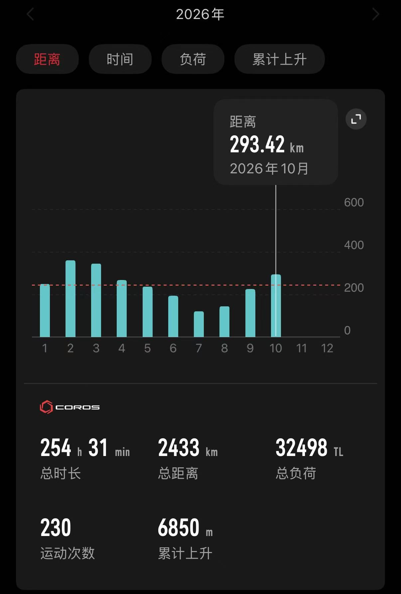
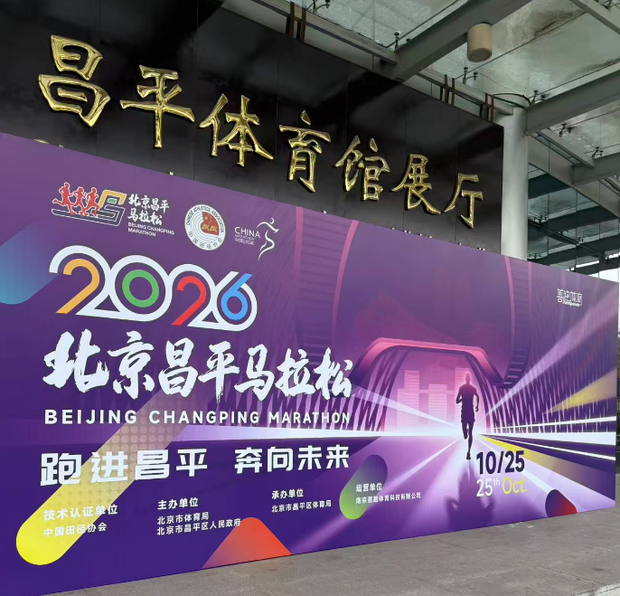
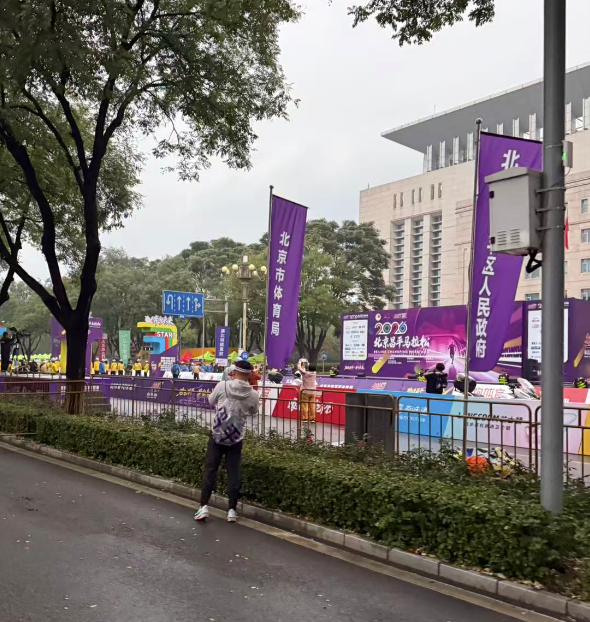
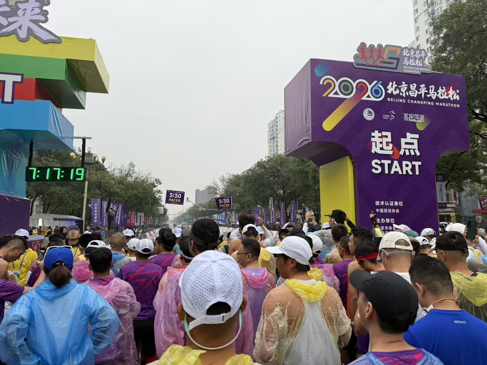
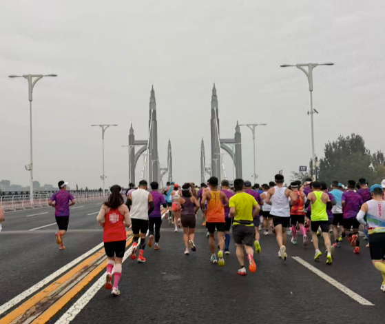
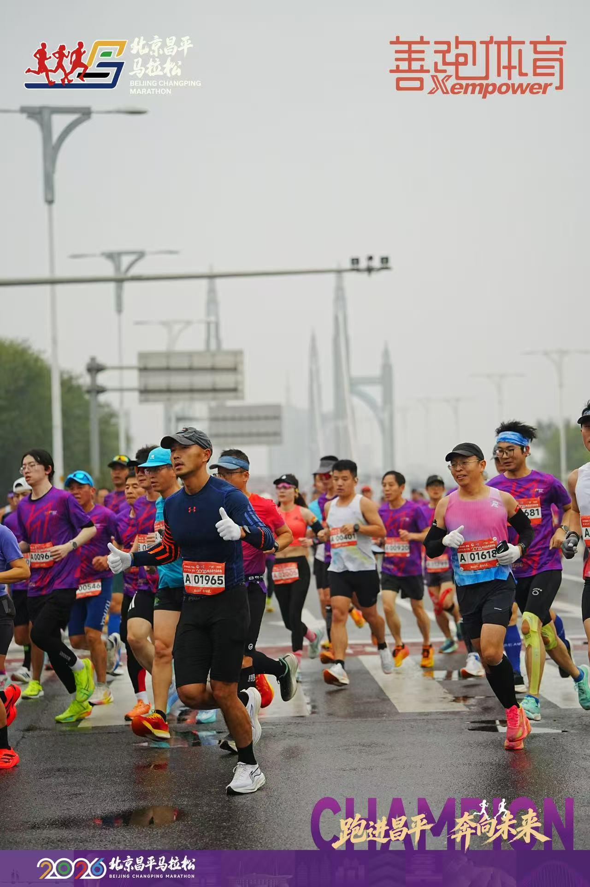
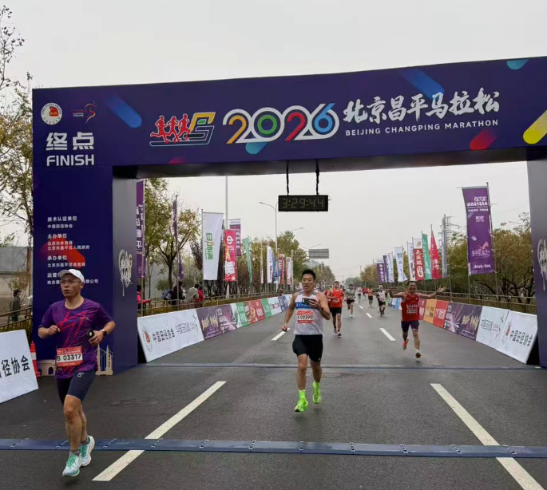

2026年10月25日，我参加并完成了第11次正式马拉松比赛，也是我第7次完成全程马拉松。比赛成绩，枪声成绩：3:29:35，净成绩：3:29:27。达成了330的成绩，实现了今年的目标。

## 赛前建设

其实本来没报名昌平马拉松，一方面是夏天的训练实在是太拉胯了，即不能保证数量也没法保证质量，没有间歇课程，可能只有一些别人口中的垃圾跑量。可以看一下2026年每月跑量统计，4月比赛季过去之后，随着天气变热跑量开始逐步下降，一直到7月降到最低，这之后才开始逐渐恢复。而且跑步大部分是以二区有氧为主，配速大多在540～615之间。

另外一方面是报了北京马拉松，期望中签体验一下「国马」的氛围。昌平马拉松出签时间靠后，担心如果两个都中了就要背靠背比赛。事后证明想多了，北京马拉松真是太难中了，已经连续三年没有中签。

9月28日，奥森跑团群里发布了有昌平马拉松赞助商名额的信息，当时刚刚知道北京马拉松出签结果，没有中签。一看我也符合昌平马拉松的条件，就提交了申请，这样参加昌平马拉松就定了下来。

随后做了四周短暂的训练，928～1004这周，因为是假期，跑了一个半马。1005～1011这周跑了一个33公里的长距离。1012～1018这周跑了一个配速513左右的半马。平均每周的跑量大概在60公里左右。

## 比赛过程

昌平马拉松开赛前，天气预报一直是100%的降雨概率，就一直担心当天要雨战。下雨的话，一方面是身体温度低，另一方面是鞋子、袜子都湿了之后，很容易磨破。一直到比赛前一天，看到昌平气象局为马拉松专门做的气象评估，预计比赛时段只有少量的降雨。

25日早，五点钟起来准备早餐，看到窗外地面湿漉漉的，但是没有下雨，应该是下过一阵雨了，心里估摸上午应该不会有太多降雨，稍微心里有点底，根据当天的气温，也准备穿短裤、背心跑。

昌平马拉松的起点在区政府前的主要干道上，采用了双向封闭的限行措施，因此赛道非常宽敞。到了之后人脸识别入场、安检、存包动线围绕体育馆拉开，整体秩序和空间非常好。进入检录区后，官方带领了规范的热身，还有摄影师在起点拱门前给选手拍照。天气条件也非常给力，温度12度左右，没有风，也没有雨。

起跑后前三公里道路开阔，积水也不多。可能是第一次在A区出发，感觉身边的人都特别快，不自觉地自己的速度也变快了。配速基本在4:45左右，跑了3公里之后就能远远望见昌平著名的大桥。

过了大桥之后开始有官方摄影师，拍出来的照片真是漂亮。

因为这次想跑一个330的成绩，后面就没怎么拍照了，专心的稳定好配速。整个路程经过了南环路、南丰路、昌崔路、安四路。路过了苹果小镇，旁边就是军都山滑雪场，小镇里面还有一个橡树谷，这几年春天的时候看山桃花也非常美丽。安四路那边经过了草莓博览园，再往南一点就要到小汤山了。

昌平的赛道折返和拐弯很少，有一些起伏，全程大概120米的上升和下降。感觉最有挑战的是返程的时候35公里到38公里的那一段上坡，那个时候体力基本上耗尽了，又赶上上坡，当时右侧大腿又有点想要抽筋的感觉，就没太敢加速，把速度放慢到了5分10秒左右。

最后，有惊无险的满足了330的目标，回看成绩，35公里之后掉速还是挺多的，这说明了最近的长距离跑的太少，后面没有力量再提速。果然马拉松真的是一份投入就有一份收获。

跑马拉松是一个自己与自己对话的过程，不光是跑步的这三四个小时，在准备跑步的这三四个月中，我们要认真体会自己一点一点的变化，不断突破自己，向着更快更高更强的目标前进。但是感觉人到四十多这个年纪，提高特别慢，下降特别快。要想不下降，那只能加紧练了，还要注意避免受伤。

破了330之后，后面的目标突然有些迷茫，感觉自己的潜力已经到顶了，后面该怎么练呢？

## 赛后服务

昌平的赛后服务组织的非常好，作为第一届马拉松来说，准备的可以说非常充分、非常有诚意。冲线之后是常规的领取完赛奖牌、完赛物资的环节。紧接着就是一个很长的拉伸区，拉伸区是在搭起的帐篷里。想起来2025年参加武汉马拉松的经历，那天也是有雨，结果赛后拉伸是在露天区域，到后面雨稍微大一点之后，瑜伽垫上就全都是水了。昌平马拉松还在瑜伽垫周边都铺上了一层薄薄的保温毯，感官更好。

拉伸区结束后是冰敷区，冰水中还洒满了红色玫瑰，快要成为药浴了，感觉像是温泉经验延伸到了马拉松赛后服务当中。

再往后有一个美食区，冰敷的时候还有大哥说这个天气就像吃一口热乎饭，没想到还没出场地就吃上了。美食区有阳坊涮肉、大包子、稻香村、香肠等各种好吃的，一路吃下来，中午饭都省了。

为这届昌平马拉松的组委会和志愿者点赞！