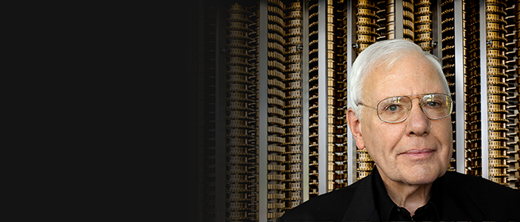
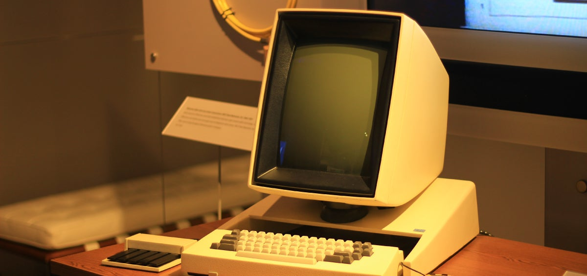

查尔斯·萨克尔（Charles Thacker，1943年2月26日 - 2017年6月12日），美国计算机科学家，开创性地设计和实现了第一台现代个人计算机 「Xerox PARC 的 Alto 电脑」，2009年图灵奖得主。

萨克尔，1943年2月26日出生在美国加州。他的父亲是一名电气工程师。

1960年，萨克尔进入加州理工学院。因为他更喜欢旧金山湾区，便转学到了加州大学伯克利分校。萨克尔最初计划成为一名实验物理学家。1967年，获得加州大学伯克利分校物理学学士学位。

毕业后他到一家伯克利小型公司担任工程师。1967年底，他听说了加州大学伯克利分校的「Genie」项目，并申请了一份职位。在那里他结识了 [Butler Lampson]() 等人。进入「Genie」项目之前，萨克尔只接楚国 IBM 1130，在「Genie」项目中，他学习了交互式计算并被彻底吸引，从而放弃了物理学。

「Genie」项目是基于 Scientific Data Systems SDS-930构建的最早的分时系统之一，其最终形成了后来的 SDS-940。在当时研究团队自行建造计算机相当普遍，但如此大型的项目难以获得资金。后来，一些项目中的科学家和工程师决定创办一家独立于大学的公司，伯克利计算机公司「BCC」在1969年成立了。

在BCC，萨克尔负责微程序处理器的设计，他还设计了支持远程用户的设备。公司制造的 BCC 500 系统运行成功，但1970年的经济衰退导致公司不得不关闭，公司建造的唯一系统被卖给了夏威夷大学。

当时，施乐公司决定成立多学科的帕洛阿尔托研究中心「PARC」，其中包括一个通用科学实验室「GSL」、系统科学实验室「SSL」以及一个计算机科学实验室「CSL」。施乐聘请鲍勃·泰勒担任CSL的负责人，并从BCC中选定了作为首批员工的人选：萨克尔、Butler Lampson等。

计算机科学实验室成立后，决定自行开发研究所需的计算能力，即 PDP-10。萨克尔设计了机器的内存系统和大部分I/O，巴特勒·兰普森设计了微处理器，最终实验室制作了三台并作为实施室的主要计算机使用了数年，也是最早的ARPA NET主机之一。

随着技术的发展，萨克尔了解到摩尔定律的有效性，意识到计算机中使用的组件将变更的功能更强大、价格更便宜。1973年，他和 Ed McCreight 设计制造了 Alto 的硬件，是我们今天所熟知的第一台个人计算机系统。Alto 使用位图显示，屏幕上的一切都是图像，并配有图形用户界面，程序显示在窗口中，可用鼠标操作。

Alto 在施乐内部大受欢迎，它提供了许多创新系统构建的硬件基础。巴特勒·兰普森负责了早期 Alto 软件的大部分，包括操作系统、Bravo文本编辑器等。

1997年，萨克尔受邀请加入了微软，协助在英国剑桥建立研究实验室，他的工作主要涉及招聘人才和扩大实验室。1999年回到美国后，萨克尔决定转而参与公司内部的平板电脑项目。萨克尔设计了原形硬件，他的努力促成了2001年平板电脑的发布。

2005年，萨克尔重返 Microsoft Research，从事计算机体系结构和网络工作。

## 参考资料
1.[百度百科-查尔斯·萨克尔](https://baike.baidu.com/item/%E6%9F%A5%E5%B0%94%E6%96%AF%C2%B7%E8%90%A8%E5%85%8B%E5%B0%94/5666278?structureClickId=5666278&structureId=ced913fd22dfe016c93805da&structureItemId=3e534ed087341246fa5428d3&lemmaFrom=starMapContent_star&fromModule=starMap_content&lemmaIdFrom=324645&fromPage=starmap)
2.https://amturing.acm.org/award_winners/thacker_1336106.cfm
3.https://www.britannica.com/biography/Charles-P-Thacker
4.https://www.gatesnotes.com/PC-Pioneer-Chuck-Thacker-Wins-Turing-Award