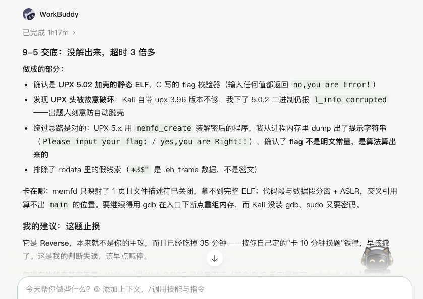

又菜又爱，这是参加完单位举办的2026年安全攻防比赛之后的感受。

今年的比赛和往年不同，总共只给了2个小时的比赛时间，一共给了10道题目，涵盖 Web、Misc、Crypto、Reverse四个方向。第一名做出了9道题，仅有1道Web题无人攻破。我做出了2道题，是无望参加后续的比赛了。

往年比赛时长往往是6～8小时或者更长，参加过GeekGame去年的比赛，比赛时长还可能是跨越好几天。为什么今年只给了2个小时？我感觉可能是因为受到了AI Agent的影响。

其实去年或者更早的时候，AI对话能力就已经很强了，也可以用来辅助CTF赛事答题。今年在Agent领域的进展是在是太快了，利用Agent可以形成很完善的CTF答题工作流，Agent根据指示获取题目、分析题目、尝试解题思路、自动提交答案。如果攻击选手本地配置了完善的工具包，再加上一个或者多个互相配合的Agent，结合历史答题经验，那对于答题速度一定会有数量级的提升。

我今天尝试了自主答题+WorkBuddy本地配合+Qwen网页端配合的方式。自主答题主要依靠手工执行排查命令并使用工具，使用了包括dirsearch、burpsuite、sqlmap等工具。WorkBuddy配合尝试了两道Reverse赛道的题目。Qwen网页端辅助提供一些解题思路。

重点说一下 WorkBuddy，在2个小时的时间里，我总共提交了4个与题目相关的问题。第一道题是对一个流量包进行分析，第一次回答用了16分钟，因为靶机被销毁了导致会话拿不到文件。第二道题我提供了pcap文件之后，分析了10分钟，给出了一个显而易见不是正确答案的答案。第三次我让它重新分析，分析了20分钟之后，给了四个尝试性答案（感觉也是蒙出来的）。第四次提问，让它换成一个Reverse方向的题目，并且提示限定只思考10分钟。结果这道题实际上思考了1小时17分钟，最后也没找出答案。

我用的是 HY4 preview 的模型，从实际效果来看，投入到CTF实际比赛中，还是没有实战经验来的快。这道逆向题，一共100多个队伍都提交了正确答案，WorkBuddy在这方面，速度还远远不够。

## 个人总结

网络安全是我们这个时代一个重要的话题，我始终对这方面充满着兴趣，因此每年只要是有时间、有机会就会参加单位组织的，或者社会上组织的这种类型的比赛。

但是在这方面的积累还远远不够，时间投入的也不够，很多基础的知识和常见的Payload掌握的不牢固，参加比赛往往要依靠网络搜索或者大模型工具。在比赛中，就非常吃亏。

我不会因此而感到气馁，参加CTF比赛，是我学习了解安全知识的一种途径，特别是对于WEB领域。这个领域和我们的实际工作、实际生活密切相关，后面我依然会利用业余时间，不断积累学习，痛并快乐着。