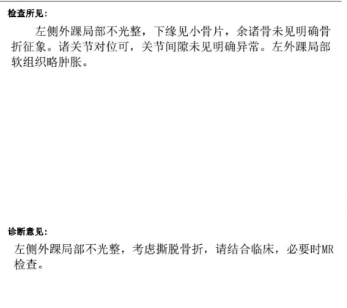
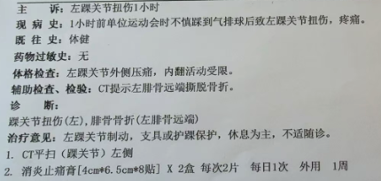
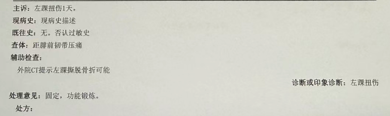
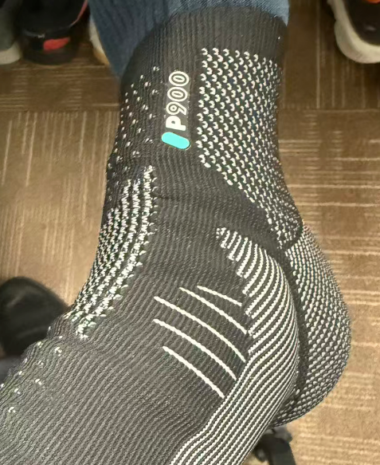
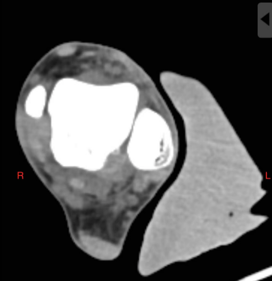

回想起来，工作之后崴脚的场景几乎都是在羽毛球场。24年的时候崴脚过一次，那次是右脚，是在第一次参加通州全程马拉松之前，养了一个月，然后安全完成了我的第一次首马比赛。

自此之后，在打羽毛球过程中，我还是比较小心，尽量避免做幅度太大的跳起动作。

10月26日，就在我跑完昌平马拉松第二天之后，我又把左脚给崴了，这次也是在羽毛球场。这次的受伤应该属于意外加工伤，两块并排的场地，一个是用来做羽毛球练习用，一个是用来做气排球比赛用。我在后退接羽毛球的时候，踩到了旁边场地滚过来的气排球。

当时感觉动作幅度并不大，医生事后说，遇到这种紧急情况，脚踝会自主的向外侧扭去，这时会产生剪切力，这种力量是极大的、有伤害性。所以脚踝受伤，应该就是踩到球的那一霎那。

当时自我感觉并不是什么大伤，还能正常走路，甚至还想歇一会继续打球。但是脚踝外侧有个位置按压特别疼，在大家的劝导下，还是决定去医院看看。

## 诊断

第一时间去医院，医生安排了CT检查，检查结果出乎我的意料。医生对着CT结果看，刚开始说问题不大，伤的部位在腓骨远端，这个骨头不是一个支撑性的骨骼，影响不大。

对CT影响的进一步分析，医生指着腓骨远端一个小图块对我说，这里有一点小撕脱，算一个撕脱性骨折。

撕脱性骨折是我第一次听到的医学名词，医生解释为韧带力量强，骨关节面力量弱，韧带把骨片撕下来一点，但是没完全掉还粘连着。建议是保守治疗，先制动，再康复。

## 再次诊断

「伤筋动骨一百天」担心真的是这么严重骨折的话，影响跑步的时间太长，我又去了北医三院做诊断。这次是个年轻的大夫，看了外院的CT结果说没事，也不用做支具固定，建议先修养至少3周，他给的诊断只是脚踝扭伤。

当时也和他讨论了下上家医院给的诊断结果，他把墙壁比喻成人体的骨骼，撕脱就是墙面有点翘起但是没有脱落。他说按照他的标准，这个应该不属于骨折。

医生建议可以用拐杖辅助走路，减少对伤脚的压力，有条件每天做几次冰敷。

## 康复

虽然两家医院诊断不同，但是都强调要制动几周，我就先完全停止了跑步，带上了在迪卡侬买的护踝（医生说这个太软了，只能起到防止肿胀的作用），用拐杖辅助走了三天。

因为也不影响上班就没休息，算上通勤，基本上每天的步数都在4000步以下。

周末休息的时候，还学习了下怎么看CT影像和脚步的骨骼结构。真的是久病成医，同样的病症，每个医生的说法和治疗建议都不太一样，现在技术这么发达，获取相关信息成本很低，自然促使受伤的人会去看一些医疗书籍、视频、文章，结合自身对伤处的感受，形成了自己的康复想法。

刷到了很多视频，伤情都比我这个严重很多。现在过去7天，我可以做到正常走路，第二天脚踝也不肿。也可以做一些下蹲、垫脚等动作。伤处有时有一些肿胀的感觉，按压还是会疼。

我计划再完全制动一周半左右，开始慢慢恢复短距离的慢跑，等满了三周再去医院复查，确认骨头没问题之后，再开始逐渐加大跑量。

每一个跑步的人，都要学会和自己的身体对话，尊重自然规律，安全的跑步，才能快乐的跑下去。