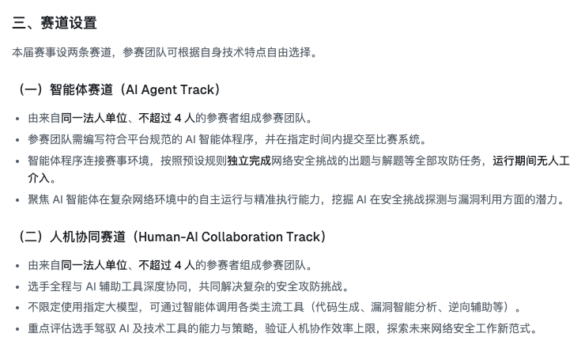
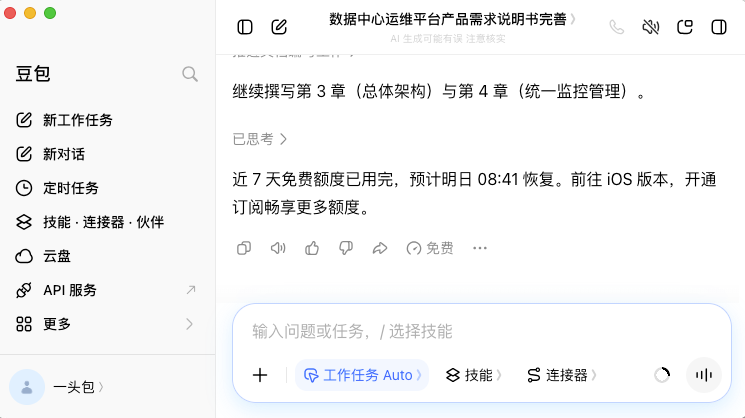
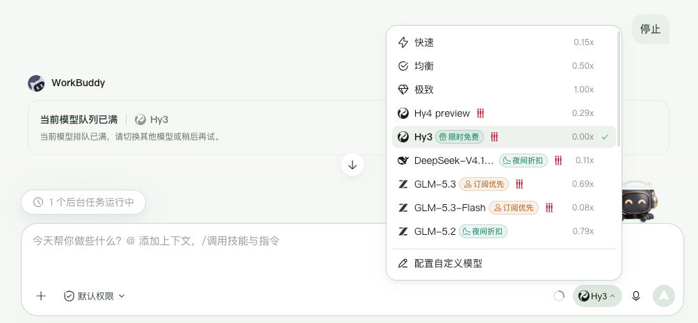
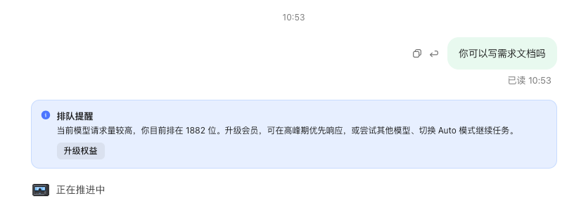
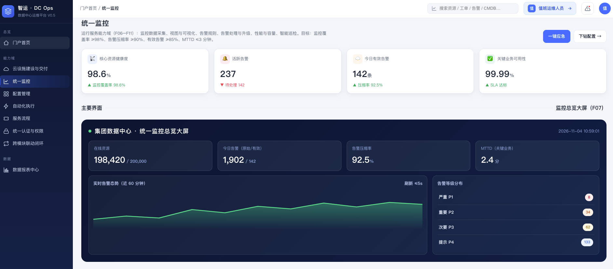
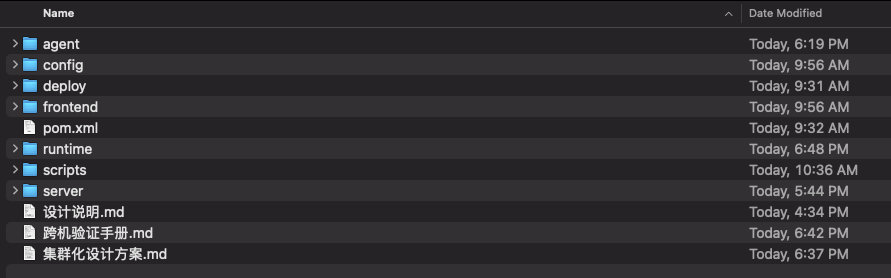
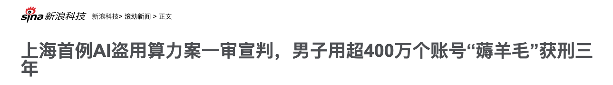

前两天参加CTF比赛，感觉AI，特别是AI Agent在辅助比赛方面作用可能会越来越大。转身就看到由中国计算机学会（CCF）主办的首届 CCF 网络安全智能挑战赛暨「京华杯」TPCTF 2026 已正式启动，这届比赛单独给Agent打CTF，设置了一个赛道。

真的是把比赛的完全交给Agent去完成，可以用本地运行的Agent，主办方也提供了云上的Agent运行环境，这真的是一届非常有创意的CTF。

这几天我在疯狂的使用各种国内的Agent产品，豆包办公、WorkBuddy、Trae，发现产品提供的免费额度，如果做一些稍微大一点的任务，额度要么会很快用完，要么就会被放进等待队列。

用 Trae，是正好看到池大有篇文章介绍刚推出了「Trace 宝」，并且免费一周。Workbuddy是一直在用，原来 HY4 Preview 限时免费，现在只有 HY3 免费了，勉强用着。豆包办公操作本地环境一直没放开，所以在效率上是这几个里面最弱的。

我尝试用豆包写需求文档，让Wrokbuddy画原型，让Trae来实现工程。原型效果乍一看还挺像回事的，但是缺少了业务逻辑和业务数据内在的真实性、稳定性，与需求文档写的质量不高有关系。

Trae写代码的能力感觉挺强的，一天到晚闷头在干活，前后端一个人全包了。

对于我这种工作上不依赖AI产出的人来说，用用这些免费的额度玩的已经很快乐了。今天看到新闻，还有人批量薅羊毛，最后被定性为「利用AI免费额度非法获利」。这有点类似于早期的优惠券网站发展阶段，这个阶段各家大模型厂商、Agent厂商都会提供一些免费的活动，有的网站提供这些优惠信息的汇总，有的人动了这些免费额度的坏主意。

「免费的其实是最贵的」，免费的额度不稳定，完全不能满足需要持续输出、快速输出、高质量输出的要求。我现在都有点想每个月固定买一点Token了，马上临近双十一，有些厂商也开始在做活动了。甚至看到李佳琦的直播间都开始卖Token，真的是太疯狂了。

算力的狂欢，估计还会持续很久。要不要上船？参加京华杯的比赛，我已经报名了队伍，需要研究下如何构建能够提交托管运行的Agent，有没有感兴趣的同伴一起组队，欢迎。