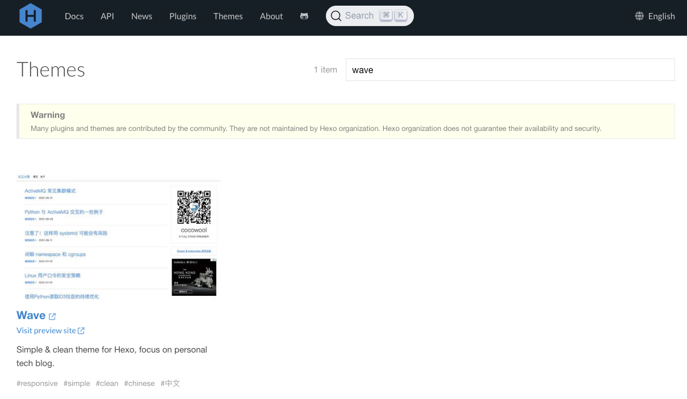
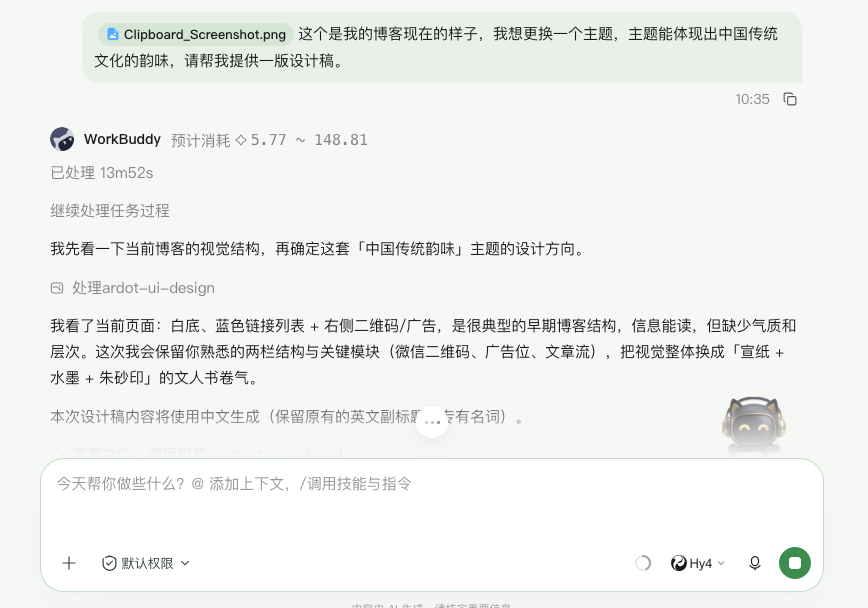
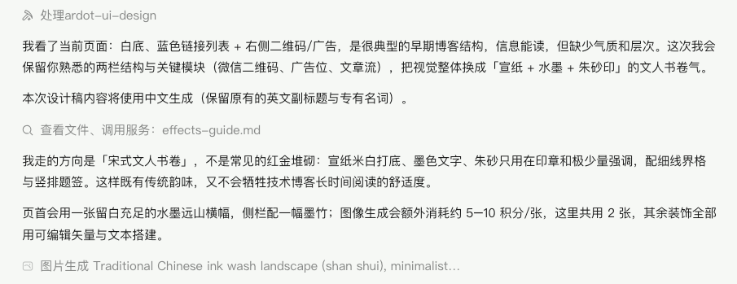
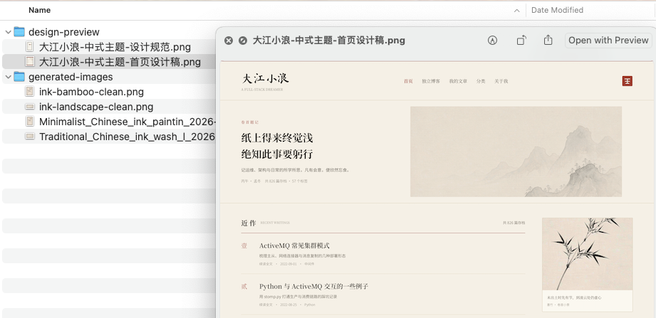
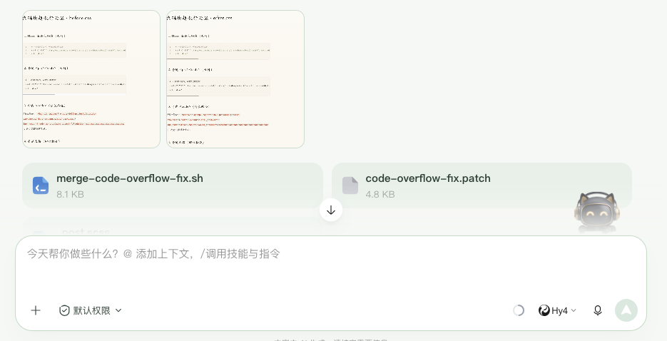
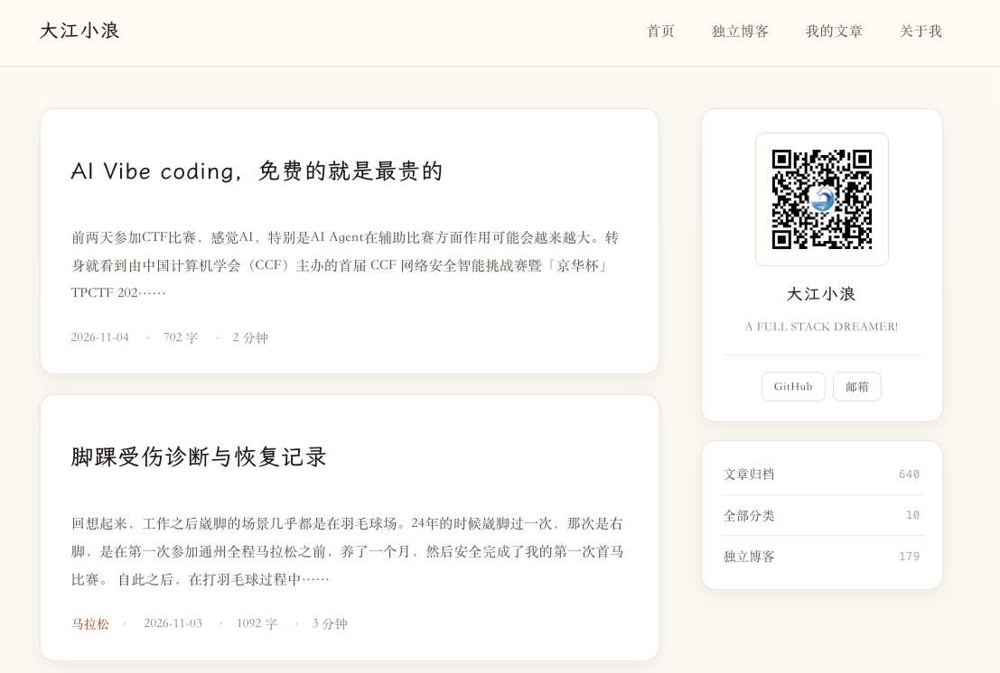

记录技术学习资料和工作、生活感悟的习惯有很多年了，之前是在CSDN、博客园这种站点发表文章。2016年之后，因为博客园限制了发布Google Adsense，便在新浪云「SAE」上用Hexo搭建了一个静态博客站点。当时还从0开始，构建了一个简单的主题，并且分享到了 「Hexo.io」 上。完全受搓大概花了一两周的时间。

后来因为新浪云关闭服务，今年将站点迁移改为用 Github Pages 托管，后来动了重新开发一个主题的心思。

9月份正好赶上 Workbuddy 和 HY4 的推广活动，提供了限时免费的服务，正好体验下下利用AI完成一个Hexo主题的设计和开发的过程。

## 界面设计

工作第一步先向 Workbuddy 提供我当前站点样式的截图，并且提出了简要的对目标主题的需求，Workbuddy 就开始全力工作了。通过界面上的输出看到 Workbuddy 的思路与执行进展，如果需要调用付费的服务，比如图片生成、语音识别，会给出提示。推测 HY4 模型在处理非文本数据时，还需要依赖外部服务。

很快就会给出交付物，交付物中不仅包含了设计规范，生成的素材图片，还有页面的预览效果截图。

后面我有提了一些细节修改的要求，最后生成了首页、内容页和链接分享页的效果图片。

## 主题代码开发

效果图确定后，我新建了一个空间和任务，将效果图图片转换为 Hexo 主题代码。这里我提了一个要求。

> 我给你指定的工作目录 A 是一个空目录，你能在 B 目录下看到我的 hexo 站点文件，你要协助我完善 historic 主题代码。但是我有一个要求，不要私自改动 B 目录中的任何文件，所有的改动都在工作目录 A 下保存验证，最后的结果以合并脚本的方式提供给我，我检查后手工合并。

Workbuddy + HY4 能够准确的理解这个要求，最后给我输出了可以手工执行代码合并的脚本，这样我的工作目录中的内容，还完全在我的掌握之中。

后面在验收过程中，我有提出了一些行间距、换行等方面的调整要求，主题的整体实现上没有大的问题，整个过程非常流畅，始终按照我的要求只在工作目录做修改和测试。

## 最后效果

借助 Workbuddy 和 HY4，我很快就完成了新主题设计和主题代码开发工作，看一下最后网站首页的效果。

不管是在PC端，还是在手机端，浏览效果都得到了保障。可以线上浏览效果 www.popsite.cn

## 感想

对于那些曾经做过开发，但是因为工作内容、精力等原因不再属于代码开发一线的人员来说，在 AI 技术的加持下，彷佛又找到了又能开发的感觉。结合之前的工作经验，能够把需求结合技术的特点，准确的下达给大模型，再通过一些交互调试，能很快的产出一个看起来可以用的交付物。

AI 确实改变了传统的软件工程项目的工作流程和工作方式，但项目上线前，始终需要有一道人工检验核查的工序不应该被绕过，特别是有重要业务影响的线上生产服务，要确保具备快速修复故障的能力，这里离不开人工的检查和值守。

不管怎么说，有 Workbuddy + HY4，我看起来又能做很多事情了。

#WorkBuddy #Hy4