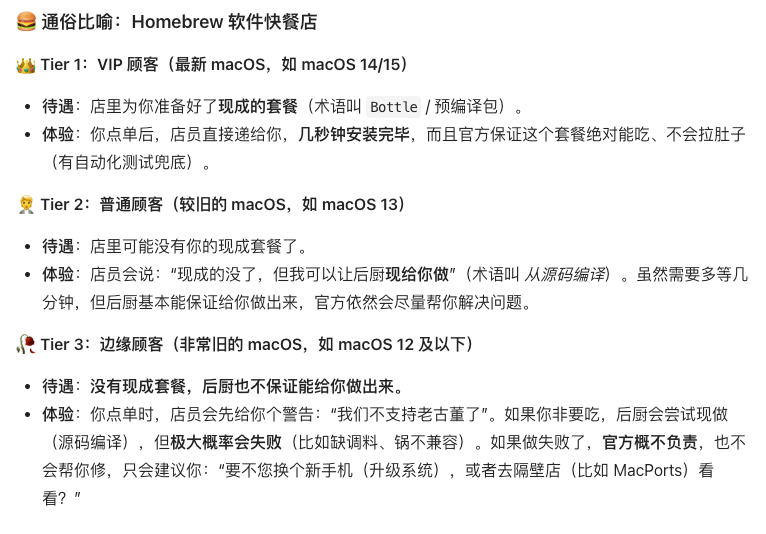
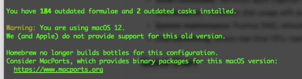
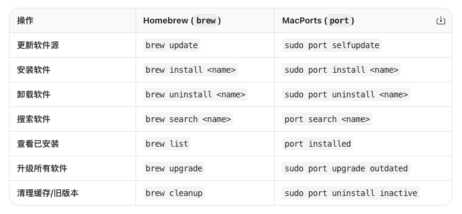
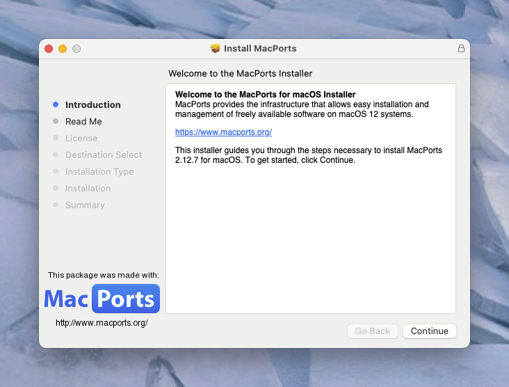

在 Mac 系统中，如果你经常使用命令行，那么对 `Homebrew` 这个工具一定不陌生，一个 `brew install` 命令，从简单的开发程序环境，到复杂的大模型工具，都能帮你自动搞定。

但是 Homebrew 提供服务时，针对不同的 macOS 操作系统版本，做了一些服务级别的区别处理。我让千问大模型帮忙整理出来。很不幸，我现在用的 2020 年购入的 MBP，运行的是 macOS Monterey Version 12.2.1，已经处于 Tier 3 级别。通过 brew 命令安装软件时，不仅享受不到直接下载编译好的安装包待遇，甚至可能不保证一定能安装成功。



核心区别用这个表可以看清楚

|级别|系统范围|Bottle|官方支持|
|---|---|---|---|
|Tier 1|macOS 14, 15|Yes|Fully Support|
|Tier 2|macOS 13|No|Not Fully Support|
|Tier 3|macOS 12及以下|No|No Support|

在这种情况下，再继续使用 Homebrew 做本机的软件包管理，变得有点痛苦。很多的时候，安装软件都需要下载源文件编译安装，不仅下载、编译速度慢，关键失败率还特别高。


## MacPorts

MacPorts 是 macOS 上历史最悠久的开源软件包管理系统之一，比 Homebrew 还早几年诞生。它的核心设计理念是「绝对隔离」和「自给自足」。Homebrew 常把软件安装在 `/usr/local` ，而 MacPorts 会把包括软件、配置文件、库文件严格安装在 `/opt/local` 目录下，保证不会污染 macOS 的原生系统环境。

MacPorts 对旧版的 macOS 提供支持性更好，甚至在 Homebrew 的安装报错界面中都推荐用户使用 MacPorts。



切换到 MacPorts 需要熟悉一些常用命令，下面这张对比图简洁明了。



## 卸载 Homebrew

先进行备份并确认备份是否成功。

```sh
# 列出当前 Homebrew 已装包，留个清单
$ brew list --formula > ~/brew-formula-backup.txt
$ brew list --cask > ~/brew-cask-backup.txt
```

卸载 Homebrew。卸载之前可以先查看下有哪些内容会被移除，方便后续有问题时排查定位，保留信息后再执行具体卸载动作。

```sh
# 官方卸载脚本
$ /bin/bash -c "$(curl -fsSL https://raw.githubusercontent.com/Homebrew/install/HEAD/uninstall.sh)" -- --dry-run

$ /bin/bash -c "$(curl -fsSL https://raw.githubusercontent.com/Homebrew/install/HEAD/uninstall.sh)"
```

## 安装 MacPorts

MacPorts 依赖苹果的命令行工具，需要先使用下面的命令检查并安装。

```sh
$ xcode-select --install
```

推荐使用官方下载的 pkg 包来进行安装。



安装完成后，按照官方的推荐，应当做一次更新。

```sh
$ sudo port -v selfupdate
```

## 日常使用

```sh
$ port search mole-cleaner
$ sudo port install mole-cleaner
Password:
--->  Computing dependencies for mole-cleaner
The following dependencies will be installed: 
 bash 
 gettext-runtime 
 libiconv 
 ncurses 
Continue? [Y/n]: y
--->  Fetching archive for ncurses
Attempting to fetch https://mirror.sjtu.edu.cn/macports/packages/ncurses/ncurses-6.6_0.darwin_21.x86_64.tbz2
Attempting to fetch https://mirror.sjtu.edu.cn/macports/packages/ncurses/ncurses-6.6_0.darwin_21.x86_64.tbz2.sig
--->  Installing ncurses @6.6_0
--->  Activating ncurses @6.6_0
--->  Cleaning ncurses                                   
--->  Fetching archive for libiconv
--->  Installing libiconv @1.19_0
--->  Activating libiconv @1.19_0
--->  Cleaning libiconv
--->  Fetching archive for gettext-runtime
--->  Installing gettext-runtime @1.0_0
--->  Activating gettext-runtime @1.0_0
--->  Cleaning gettext-runtime
--->  Fetching archive for bash
```

体验下来，安装速度确实比 Homebrew 好多了。资料介绍说 MacPorts 也有下载比较慢、需要频繁输入root口令的问题，对比Homebrew不能完成任务，这些小缺点可以忍受。

## 题外话

MacbookPro 真的是非常经用的笔记本，虽然初始购置成本比较高，结合使用年限来看，平均每年的费用不一定高。我现在用的这台就是2020年购入的，从现在使用体验来看，还可以用上个两三年没问题。

这些年AI、AI Agent发展越来越迅猛，我也是非常眼馋最新款的 MBP 可以在本地跑大模型的能力，好好工作，争取几年后换一个趁手的 MBP。

## 参考资料
1. [Homebrew homepage](https://brew.sh/)
2. [MacPorts](https://www.macports.org/)
3. https://www.macports.org/install.php#installing